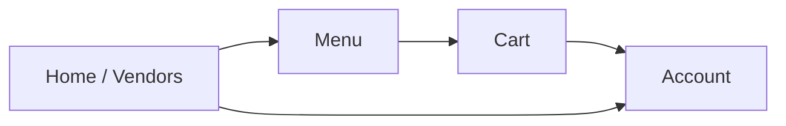

# Campus Food Ordering UI (HCI Milestone)

Interactive UI prototype for a **multi-vendor campus food ordering** experience — browse vendors, view menus, manage a cart, and open an account screen.

Originally scaffolded from a Figma HCI milestone design and implemented as a React + Vite TypeScript client.

## Elevator pitch
A recruiter-friendly front-end case study showing information architecture, interaction flow, and component structure for an on-campus ordering product.

## App flow



## Tech stack
- React 18 + TypeScript
- Vite 6
- Radix UI primitives + utility styling
- Componentized screens: `HomeScreen`, `MenuScreen`, `CartScreen`, `AccountScreen`

## Features
- Vendor browsing on the home screen
- Categorized menu items with pricing and prep metadata
- Cart add/update flow
- Account screen shell for profile/order context
- Responsive layout oriented for mobile-first HCI evaluation

## Setup
```bash
git clone https://github.com/AbdulHakeem007/Hcimilestone4.git
cd Hcimilestone4
npm install
npm run dev
```

| Script | Purpose |
|---|---|
| `npm run dev` | Local Vite dev server |
| `npm run build` | Production build |

No backend environment variables are required for the current mock-data prototype.

## Project structure
```
src/
  components/     # screens + UI primitives
  styles/         # global styles
  App.tsx         # screen orchestration
```

## Design source
Figma: [HCI Milestone 3 Iteration 1](https://www.figma.com/design/bWzeq4wvmfAGyRrRHybRs0/HCI-Milestone-3-Iteration-1)

## License
MIT — see [LICENSE](./LICENSE).
